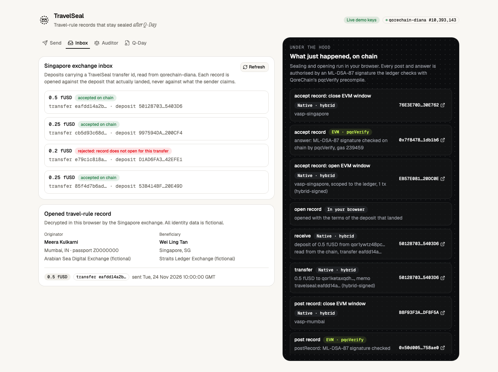
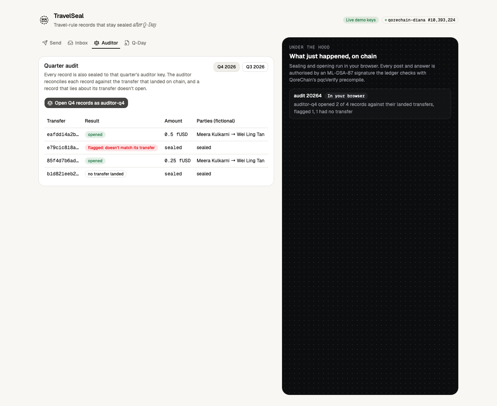
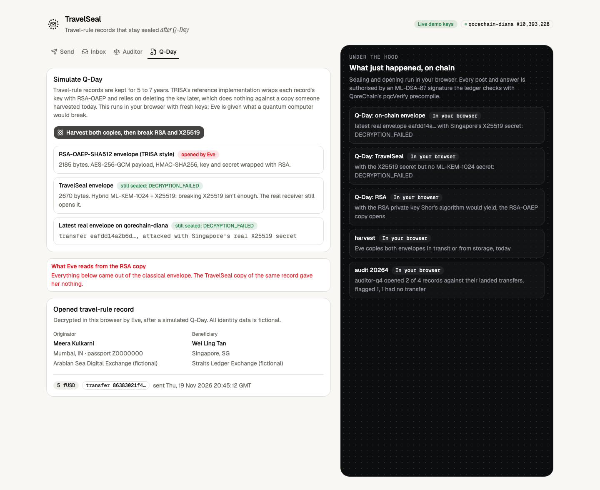

# TravelSeal

[Landing page](https://travelseal.vercel.app) · [Explore the replay](https://travelseal.vercel.app/demo)

Travel-rule data between exchanges, sealed so a copy taken today stays unreadable after Q-Day.

When an exchange sends crypto to another exchange, it must send the customer's identity data with it (the FATF travel rule) and keep it for years. TravelSeal seals each record in the browser with ML-KEM-1024 (QoreSeal hybrid mode) to the receiving exchange's key registered on QoreChain, and binds it to the transfer it describes: if the transfer that lands on chain differs in amount, asset, sender, beneficiary or transfer ID, the record does not open.

Built for **Build Before Q-Day: The QoreChain Developer Fest** (Encrypted Apps). All identity data is fictional; this is a reference design, not a compliance product.



## Status

- [x] Accounts, ML-DSA-87 registration with proof of possession, ML-KEM-1024 registration, recipient cards (`packages/core`, `scripts/register.ts`)
- [x] Records sealed to the receiver and an auditor quarter, bound to the transfer terms (`packages/core/src/seal.ts`, `binding.ts`)
- [x] On-chain ledger with ML-DSA-87 approvals checked by `pqcVerify` / `pqcKeyStatus` (`contracts/src/TravelRuleLedger.sol`), live at [`0xccdff2afed218fed224811edc18b5ebac569536c`](https://explore.qore.network/address/0xccdff2afed218fed224811edc18b5ebac569536c)
- [x] Transfer, receive and accept or reject: the receiver rebuilds the terms from the deposit that landed (`packages/core/src/observe.ts`); a record that does not open for them is rejected on chain (`scripts/scenario.ts accept|tamper`)
- [x] Auditor quarters: each quarter's auditor opens only its quarter's records, each checked against the transfer that landed, and flags records that don't match (`scripts/audit.ts`); end-of-retention key destruction (`scripts/shred.ts`)
- [x] Simulated Q-Day: a TRISA-style RSA-OAEP envelope opens for whoever gets the RSA key; the TravelSeal envelope stays closed without the ML-KEM secret (`packages/core/src/trisaClassic.ts`, `test/qday.test.ts`)
- [x] App (`app/`): Send, Inbox, Auditor and Q-Day screens; sealing, signing and opening run in the browser; every step links to its transaction. Replay mode for the public deploy holds no keys.

On-chain evidence for every step: [docs/EVIDENCE.md](docs/EVIDENCE.md).

## Run

```sh
pnpm install
pnpm test                 # offline tests
pnpm ts setup.ts          # creates 4 testnet accounts in .secrets/ (git-ignored)
# claim the faucet once for vasp-mumbai: https://dashboard.qorechain.io/faucet
pnpm ts register.ts       # registers keys, funds the other accounts, writes recipient cards
pnpm ts k1.ts             # seals a record from on-chain keys and checks who can open it
pnpm ts deploy-ledger.ts  # opens a one-tx EVM window, deploys the ledger, closes the window
pnpm ts k2.ts             # posts a sealed record, authorised by an ML-DSA-87 signature checked on chain
pnpm ts negative-checks.ts # forged and tampered posts revert on the live ledger
pnpm ts swap.ts 10        # buys demo fUSD with QOR on the native AMM (pool 2)
pnpm ts scenario.ts accept # post record, send 0.25 fUSD, receiver opens it and accepts on chain
pnpm ts scenario.ts tamper # record says 0.25, 0.20 lands: it does not open and is rejected on chain
pnpm ts scenario.ts grief  # a third party copies the memo onto its own deposit: left unanswered, the real one is accepted
pnpm ts scenario.ts accept q3 # same, filed under Q3 for auditor-q3
pnpm ts audit.ts q4       # the Q4 auditor opens Q4 records against their landed transfers
pnpm ts shred.ts q3 --yes # end of retention: remove auditor-q3's ML-KEM key on chain, destroy its mnemonic
(cd contracts && forge test)  # 22 contract tests with the precompiles mocked at their real addresses
```

## App

```sh
pnpm app                  # vite dev on 127.0.0.1; serves the demo keys from .secrets/ to localhost only
pnpm --filter @travelseal/app e2e:flow     # drives Send then Inbox through the UI, on chain
pnpm --filter @travelseal/app e2e:screens  # Auditor and Q-Day, in live mode or against a production build (replay)
```

The production build (`pnpm app:build`) has no keys: it reads records, transfers and answers from qorechain-diana and runs the Q-Day simulation with fresh in-browser keys. REST goes through a same-origin `/lcd` rewrite (`app/vercel.json`) because the public REST endpoint sends no CORS headers.

| Auditor | Q-Day |
|---|---|
|  |  |

## Credits

Uses the QoreChain SDK, QoreSeal, QoreSign and qorechain-pqc (Apache-2.0) from [github.com/qorechain](https://github.com/qorechain). See [AI_USAGE.md](AI_USAGE.md) for how AI tools were used.

## License

MIT
